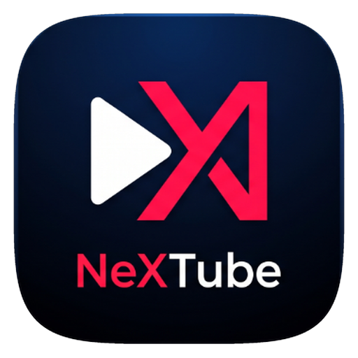

  

<h1 align="center">NeXTube</h1>

  <b>The Next-Generation, Ad-Free Video Streaming Client for Android.</b>
   
  Fast. Lightweight. Distraction-Free.

  
  
  

  

---

## ✨ Features

- 🚫 **Zero Video Ads:** Stream uninterrupted without pre-roll ads, mid-roll interruptions, or annoying popups.
- 🪟 **Floating Picture-in-Picture (PiP):** Freely draggable miniplayer that lets you watch while using any other application.
- 🔄 **1-Tap Subscriptions Sync:** Effortlessly sync your subscriptions directly to your local device in seconds.
- 🎧 **Background Audio Playback:** Listen to podcasts, music, and streams with your screen off or in the background.
- ⚡ **Native Hardware Acceleration:** Smooth 60/120Hz gesture animations, zero lag, and ultra-fast start times.
- 💬 **Interactive Comments & Descriptions:** Read discussions, check video chapters, and interact through native slide sheets.
- 🔒 **Privacy-First:** No invasive account mandatory for streaming, zero background telemetry, and zero bloat.

---

## 📥 How to Install

1. Download the latest **`NeXTube-v1.0.0.apk`** from the [**Releases Page**](https://github.com/nextube-project/NeXTube/releases/latest).
2. Open the downloaded APK on your Android device.
3. If prompted, allow **"Install Unknown Apps"** for your browser or file manager.
4. Tap **Install** and launch **NeXTube**!

---

## 💡 Troubleshooting & Requirements

- **Android Version:** Android 8.0 (Oreo) or higher.
- **Architectures Supported:** `arm64-v8a`, `armeabi-v7a`, `x86_64`.
- **Issues / Suggestions:** Have a bug or feature request? Submit an [Issue](https://github.com/nextube-project/NeXTube/issues).

---

## ☕ Support the Project

NeXTube is maintained independently. If you love the app and want to support continued development, consider starring ⭐ the repository and sharing it with friends!

---

## ⚖️ Disclaimer

NeXTube is an independent project and is not affiliated with, endorsed by, or associated with Google LLC or YouTube. All trademarks and brand names are the property of their respective owners.
